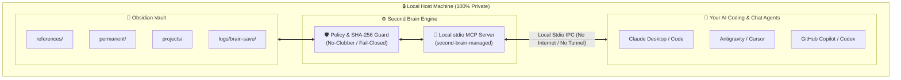

<p align="center">
  
</p>

```
  CAPTURE           STAGE             GATE             VAULT            RECALL
┌─────────┐      ┌───────────┐    ┌───────────┐    ┌───────────┐      ┌─────────┐
│ AI Chat │ ───> │ Candidate │ ─> │  SHA-256  │ ─> │ Canonical │ ───> │ Any AI  │
│ Desktop │      │  Staging  │    │  Policy   │    │ Vault .md │      │  Agent  │
└─────────┘      └───────────┘    └───────────┘    └───────────┘      └─────────┘
 /brain-save      fail-closed      no-clobber        Obsidian        /brain-recall
```

<p align="center">
  <a href="https://www.python.org/"></a>
  <a href="LICENSE"></a>
  <a href="https://github.com/Heiron8/ai-second-brain-toolkit/actions"></a>
  <a href="https://modelcontextprotocol.io/"></a>
  <a href="SECURITY.md"></a>
  
</p>

<p align="center">
  <b>Zero cloud subscriptions</b> • <b>Strict local stdio IPC</b> • <b>Single-source Markdown truth</b> • <b>No-clobber staging</b>
</p>

<p align="center">
  <a href="#-quickstart-30-seconds">Quickstart</a> •
  <a href="#-commands--capabilities">Commands</a> •
  <a href="#️-architecture--data-flow">Architecture</a> •
  <a href="#-universal-ai-client-setup">Client Setup</a> •
  <a href="SECURITY.md">Security</a> •
  <a href="CONTRIBUTING.md">Contributing</a>
</p>

---

## ⚡ Commands & Capabilities

7 tools that map to the development and memory lifecycle. Each one activates the right safety skills automatically.

| What you're doing | Command / Tool | Key principle |
|---|---|---|
| **Capture session outcomes** | `/brain-save` | Explicit current-context staging; zero silent background scraping |
| **Stage candidate drafts** | `scripts/migrate.py` | Isolated staging outside Git and OneDrive |
| **Verify cryptographic pins** | `SHA-256 Grant Guard` | Tamper-evident integrity; changed bytes refuse replay |
| **Atomic vault publication** | `scripts/publish_memory.py` | Strict no-clobber; existing notes are never overwritten |
| **Recall verified notes** | `/brain-recall` | Read-only lexical & semantic search; hash-cited Markdown excerpts |
| **Maintain knowledge graph** | `scripts/wiki_memory.py` | Conservative wikilinks and cross-session claim deduplication |
| **Audit local health** | `scripts/install_toolkit.py --check-only` | Fail-closed diagnostic report; zero cloud telemetry |

---

## 🌟 Why AI Second Brain?

Most AI memory systems require paid cloud databases, continuous internet exposure, or sending your raw personal notes to external servers.

**AI Second Brain Toolkit** takes the opposite approach:
- 🔒 **100% Local & Private:** Runs entirely on your local machine over standard input/output (stdio IPC). Zero web tunnels, zero listening network ports, and zero leakage of your OS username or local drive paths.
- 💰 **$0 Monthly Subscriptions:** Works directly with your local Obsidian vault (and OneDrive/iCloud sync) and your existing AI desktop apps.
- 🛡️ **Cryptographic Integrity & Safety:** Uses SHA-256 grant pinning, no-clobber atomic writes, DOS-device protection, and boundary traversal defenses.
- 🤖 **Universal AI Client Support:** Interoperable with **Claude Desktop / Claude Code**, **Cursor**, **GitHub Copilot / Codex**, and **Google Antigravity**.

---

## 🏛️ Architecture & Data Flow



---

## 🚀 3-Step Quickstart

### Step 1: Validate Your Environment
Clone the repository and run the non-destructive environment health check:

```powershell
# In PowerShell:
.\scripts\install.ps1 --check-only
```
The diagnostics tool checks for Python 3.11+, automatically locates your Obsidian vault, and validates dependencies.

---

### Step 2: Initialize Private Workspace
Run the installer to set up your isolated private staging workspace and baseline templates (strict no-clobber):

```powershell
.\scripts\install.ps1
```
> [!NOTE]
> All personal transcripts, cryptographic grants, and private notes live outside this repository (in `.ai-second-brain-private/`). Your personal data is never committed to Git.

---

### Step 3: Connect Your AI Agent

Add the local MCP server to your AI tool of choice.

#### For Claude Desktop / Cursor:
Add to your `claude_desktop_config.json` or Cursor MCP settings:

```json
{
  "mcpServers": {
    "second_brain": {
      "command": "python",
      "args": ["-B", "C:\\path\\to\\AI-Second-Brain-Tools\\scripts\\managed_memory_mcp.py"],
      "env": {
        "SECOND_BRAIN_MANAGED_GRANT": "C:\\path\\to\\.ai-second-brain-private\\grants\\managed-grant.json",
        "SECOND_BRAIN_MANAGED_GRANT_SHA256": "<YOUR_GRANT_SHA256>",
        "SECOND_BRAIN_MANAGED_CLIENT": "claude-anthropic"
      }
    }
  }
}
```

#### For Codex / GitHub Copilot CLI:
Add to `.codex/config.toml`:

```toml
[mcp.servers.second_brain]
command = "python"
args = ["-B", "C:\\path\\to\\AI-Second-Brain-Tools\\scripts\\managed_memory_mcp.py"]
env = { SECOND_BRAIN_MANAGED_GRANT = "C:\\path\\to\\.ai-second-brain-private\\grants\\managed-grant.json", SECOND_BRAIN_MANAGED_GRANT_SHA256 = "<YOUR_GRANT_SHA256>", SECOND_BRAIN_MANAGED_CLIENT = "codex-openai" }
```

---

## ⚡ Core Skills & Daily Workflow

| Skill / Command | Description | What It Does |
| :--- | :--- | :--- |
| **`/brain-recall <query>`** | Selective semantic memory recall | Searches your enrolled notes within strict boundaries (max 40 lines, 8000 characters). Returns excerpts, source hashes, and clickable `obsidian://` links. |
| **`/brain-save`** | Context outcome capture | Privately stages and publishes verified decisions, lessons learned, and progress notes into `logs/brain-save/`. Never clobbers existing knowledge. |

---

## 📦 Component Readiness & Capabilities

| Component | Status | Security & Verification |
|---|---|---|
| **Managed Markdown Reader (`scripts/managed_memory.py`)** | ✅ Production Ready | Bounded reads (≤40 lines), SHA-256 hash validation, DOS device checks, sanitized vault-relative paths. |
| **Local Stdio MCP Transport (`scripts/managed_memory_mcp.py`)** | ✅ Production Ready | Standard input/output transport only. Error redaction prevents internal path disclosure. |
| **Create-Only Memory Publisher (`scripts/publish_memory.py`)** | ✅ Production Ready | Strict no-clobber atomic writes with lock protection and recovery journaling. |
| **Interactive Context Capture (`scripts/save_interactive_memory.py`)** | ✅ Production Ready | Stages proposals in private staging before owner publication. |
| **Single-Command Installer & Health Check (`scripts/install_toolkit.py`)** | ✅ Production Ready | Zip-slip protection, junction/symlink dereference guards, automated vault discovery. |
| **ChatGPT Historical Importer (`scripts/import_export.py`)** | ✅ Production Ready | Bounded intake of OpenAI data exports; synthesizes wiki-compatible source references. |
| **Wiki Synthesis & Health (`scripts/wiki_memory.py`, `scripts/wiki_health.py`)** | ✅ Production Ready | Broken link detection, orphan analysis, and cross-session linking. |

---

## 🛡️ Security, Privacy & Boundary Guarantees

1. **No External Processing Without Explicit Approval:**
   Enrolled notes carry `external_processing: false` by default. Model recall requires explicit owner grant approval.
2. **Path & Device Boundary Protections:**
   All path operations enforce strict boundary checks: Windows device names (`CON`, `PRN`, `AUX`, `NUL`), directory junctions, and path traversal sequences (`..`) are strictly rejected.
3. **Anonymized Local Output:**
   Citations return vault-relative paths (e.g. `references/user-profile.md`) rather than host filesystem paths (`C:\Users\<username>\...`), ensuring your computer username and folder structure are never leaked to cloud AI providers.
4. **Hermetic Test Suite:**
   All 454 unit tests run on synthetic, disposable fixtures. Zero personal notes or credentials exist in this repository.

---

## 🧪 Running Tests

Windows with CPython 3.13 is the primary tested environment (Python >= 3.11 supported):

```powershell
# Run the complete test suite (stdlib + optional MCP):
python -m unittest discover -s tests -v
```

To install locked MCP runtime dependencies:
```powershell
python -m pip install --index-url https://pypi.org/simple --require-hashes -r requirements-mcp.lock
```

---

## 📚 Documentation Index

- [Architecture & Contract Specification](docs/brain-memory-contract.md)
- [Brain-Save Publishing Spec](docs/brain-save-publication-spec.md)
- [Client Compatibility Guide](docs/client-compatibility.md)
- [Export Intake & Migration](docs/export-intake.md)
- [Wiki Health Diagnostics](docs/wiki-health.md)
- [Contribution Guidelines](CONTRIBUTING.md)
- [Security Policy](SECURITY.md)
- [Third-Party Licenses & Attribution](THIRD_PARTY.md)

---

## 📄 License & Attribution

This toolkit is licensed under the [MIT License](LICENSE).  
Copyright (c) 2026 Ahron Vince Gingco (Heiron8).

It incorporates format references from [kepano/obsidian-skills](https://github.com/kepano/obsidian-skills) (MIT) and design inspiration from [Graphify](https://github.com/Graphify-Labs/graphify) (Apache-2.0 / MIT). See [THIRD_PARTY.md](THIRD_PARTY.md) for full upstream provenance.
